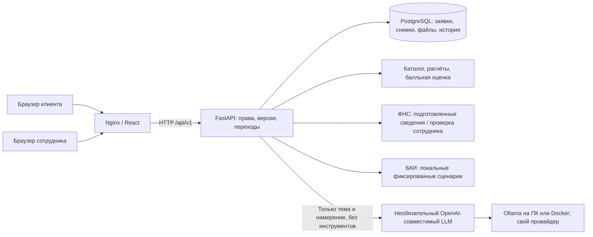
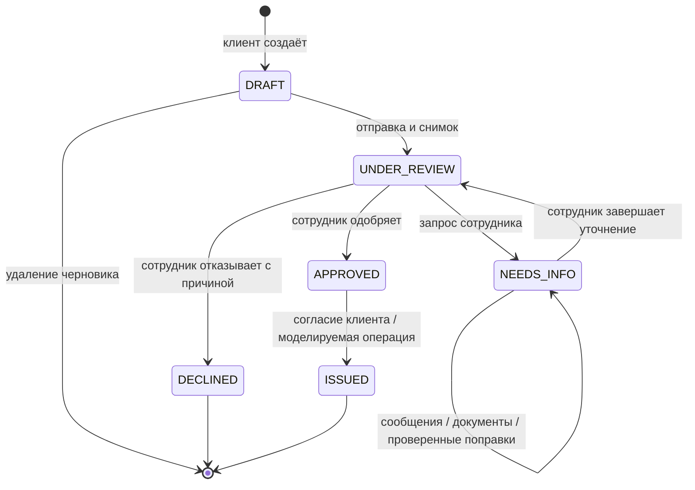
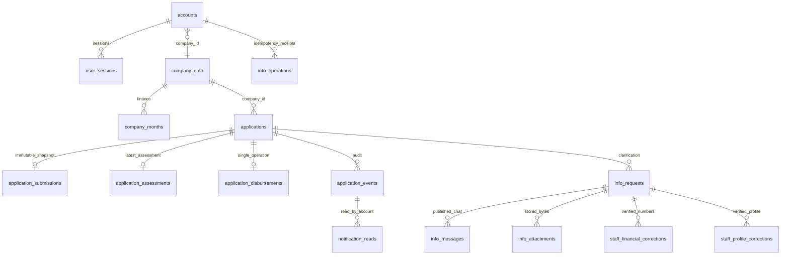

# Архитектура и границы MVP

## Компоненты и обмен

ФНС и БКИ — внутренние функции, отдельные сервисы и сетевые запросы не нужны. Финансы `BANK_DATA` хранятся в синтетическом банковском наборе. Отправка фиксирует исходные сведения и версии. Поздние исправления накладываются только на карточку этой заявки; глобальный профиль и исходный снимок не переписываются.

Помощник получает только сообщение, ограниченную историю и код выбранного продукта. Не получает автоматически ИНН, финансы, документы и результаты проверок. Его ответ разбирается по закрытой JSON-схеме; публичный текст выдаёт сервер. Ключ провайдера хранится в окружении backend. Основной процесс не зависит от LLM.

## Реальные состояния

`KEEP_UNDER_REVIEW`, `REQUEST_INFO`, `RECOMMEND_DECLINE`, `OFFER_REQUESTED` — рекомендации, не статусы заявки. Сотрудник явно запускает уточнение и принимает решение. При недоступном БКИ итоговое решение блокируется до повторной проверки. При открытом уточнении решение недоступно. Статусы `OFFERED`, `SIGNED`, `CANCELLED` из ранних проектов в текущем API не реализованы. Согласие и условная выдача объединены в одну транзакцию; отдельной юридической подписи нет. Для овердрафта `ISSUED` означает открытие лимита, не реальную оплату.

## Модель данных

Диаграмма показывает логические связи; `company_id` связывает демонстрационные данные и аккаунты, не отдельную сущность юридического лица. Сотрудник не привязан к компании. Дополнительные технические таблицы `application_creations` и `info_operations` хранят квитанции повторных операций. Точный набор столбцов и ограничений — `backend/app/models.py`.

Файлы до 5 МБ хранятся в PostgreSQL вместе с метаданными и SHA-256. До явной отправки доступ на чтение/скачивание ограничен автором. Доступ проверяется сервером, а не только скрытием интерфейса. История не раскрывает частные черновики.

## Надёжность и ограничения

- Авторизация: cookie-сессия, роли CLIENT/STAFF, изоляция компаний; вход демонстрационный, без регистрации и пароля.
- Версии предотвращают незаметное перетирание данных. Idempotency-Key защищает критичные операции от повторов; выдача дополнительно уникальна на заявку.
- PostgreSQL volume сохраняет данные при перезапуске. Синтетический набор добавляется без сброса существующей базы. Это не система автоматического резервного копирования.
- Денежные расчёты на сервере используют Decimal. Кредитные границы и допустимые переходы не делегируются браузеру или LLM.
- Внешние обращения LLM ограничены по длине, времени, размеру ответа; один одновременный запрос на процесс. Это ограничение прототипа, не промышленный SLA.
- Локальные HTTP-порты привязаны к 127.0.0.1. Для публичной промышленной установки нужны настоящая авторизация, TLS, управление секретами, антивирусная проверка файлов, резервное копирование, миграции и централизованный мониторинг.
- Нет реальных ФНС/БКИ, OCR, платёжных проводок, юридической подписи, автоматического встречного предложения и посткредитного обслуживания. Тексты не являются настоящими условиями Альфа-Банка.
